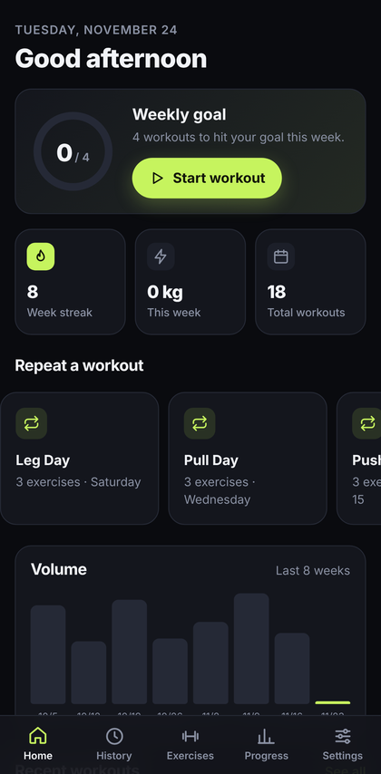
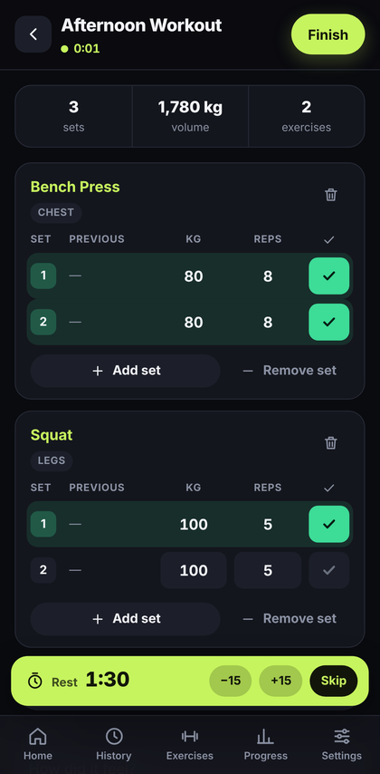
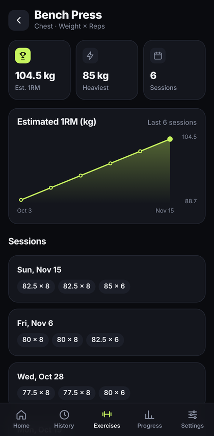
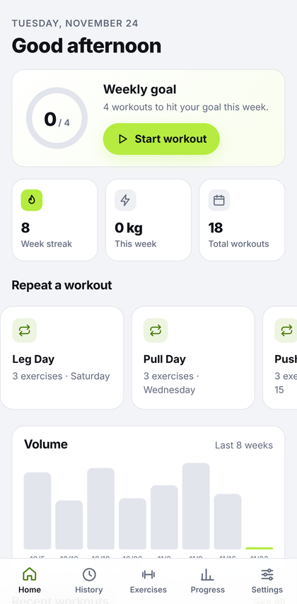

# RepLog: Workout Tracker

A fast, modern workout tracker built with **C# and Blazor WebAssembly**. It installs on your Android phone like a native app, works offline at the gym, and keeps your data private on your device.

**Live app:** https://jhill812.github.io/Workoutapp/ (after GitHub Pages is enabled; see [Deploying](#deploying))

<p>
  
  
  
  
</p>

## Features

- **Live workout logging**: add exercises, then log weight × reps, bodyweight reps, or time and distance for cardio. Check off each set as you finish it.
- **Previous-session hints**: every set shows what you did last time. Tap a hint to copy it. New exercises are pre-filled from your last session.
- **Rest timer**: starts automatically when you check off a set. Adjust it ±15s, and it vibrates and beeps when time is up. It keeps running while you move around the app.
- **Repeat workouts**: start a new session from any recent workout with one tap.
- **Dashboard**: weekly goal ring, week streak, weekly volume chart and recent workouts.
- **Progress**: workouts per week, muscle-group split, and personal records for every exercise. Each exercise has an estimated-1RM trend chart and a full session history.
- **54 built-in exercises**, plus your own custom exercises.
- **kg/km or lb/mi**: switch at any time. Data is stored in metric, so nothing is lost in conversion.
- **Dark, light or system theme**, a bottom tab bar on phones and a sidebar on desktop.
- **Backup**: export and import all your data as JSON.

## Install on Android

1. Open the live app in **Chrome**.
2. Tap **⋮ → Add to Home screen** (or **Install app**).
3. Launch **RepLog** from your home screen. It runs full-screen, without browser bars, and works offline.

> Your data is stored in the browser on that device. Use **Settings → Export backup** regularly, and to move to a new phone.

## Tech stack

| Layer | Choice |
|---|---|
| UI | Blazor WebAssembly (.NET 10), Razor components, hand-written CSS design system |
| App type | Progressive Web App (manifest + service worker for offline/installable) |
| Storage | Browser `localStorage` via JS interop, behind an `IKeyValueStore` abstraction |
| Serialization | `System.Text.Json` source generation (trim-safe) |
| Tests | xUnit (domain/services) + bUnit (components) + Playwright end-to-end |
| CI/CD | GitHub Actions → GitHub Pages |

## Project structure

```
src/WorkoutTracker/
  Models/        Domain types, built-in exercise library, unit conversion & formatting
  Services/      WorkoutService (data + persistence), Stats (pure analytics),
                 RestTimerService, DeviceService (vibration/sound/files), storage
  Components/    Reusable UI: ExerciseCard, ExercisePicker, charts, sheets, dialogs
  Pages/         Home, WorkoutPage, History, Exercises, ExerciseDetail, Progress, Settings
  Layout/        App shell: sidebar (desktop) / tab bar (mobile), active-workout banner
  wwwroot/       index.html, CSS, JS helpers, PWA manifest, service worker, icons
tests/WorkoutTracker.Tests/   Unit + component tests
.github/workflows/            Build, test & deploy pipeline
```

## Run locally

Requires the [.NET 10 SDK](https://dotnet.microsoft.com/download).

```bash
dotnet run --project src/WorkoutTracker    # then open the URL it prints
dotnet test                                # run the test suite
```

To try it on your phone during development, run `dotnet run --project src/WorkoutTracker --urls http://0.0.0.0:5000` and open `http://<your-PC-IP>:5000` on a phone on the same Wi-Fi. (Install-to-home-screen and offline mode need HTTPS, so use the deployed site for those.)

## Deploying

Every push runs the tests. Pushes to the **default branch** also publish to GitHub Pages.

One-time setup: in the repo, go to **Settings → Pages → Build and deployment → Source** and choose **GitHub Actions**. Then re-run the workflow, or push again.

The workflow sets the `<base href>` to `/<repo-name>/` before publishing. It also adds a `404.html` SPA fallback so deep links work, and a `.nojekyll` file.
